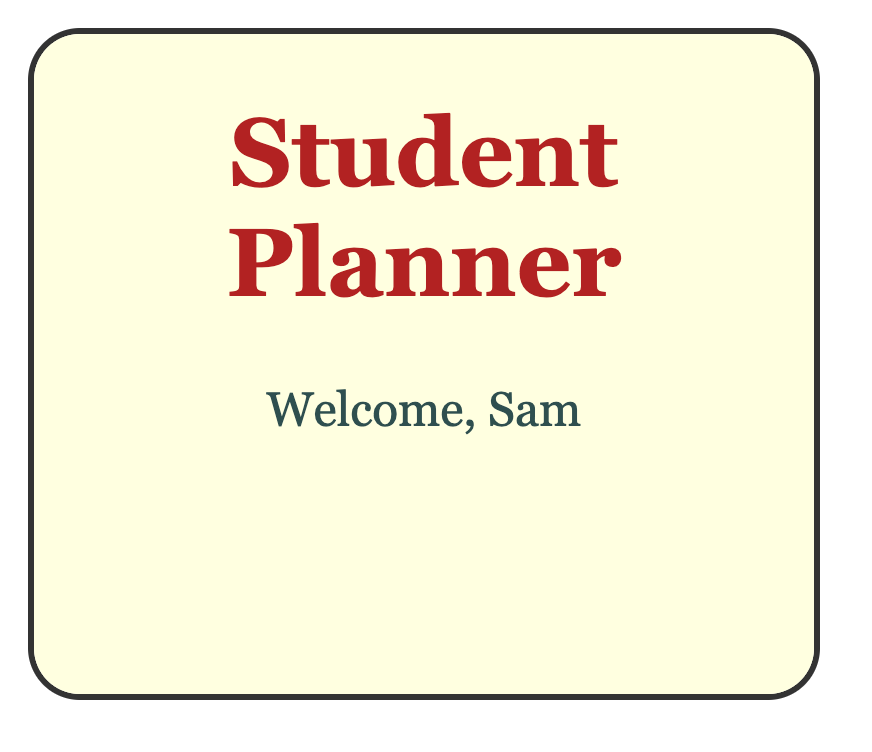

# 1.4: Colour and type

About 25 minutes.

By the end of this lesson your page will have its own text colour, its own font and a heading that is bigger than the rest. You will know two ways to write a size, pixels and rem, and why we use rem. You will also see your page at different zoom levels and on a phone-sized screen.

## The idea

A CSS file is a list of rules. Each rule is about one kind of tag. Rules follow the same layout as your tags:

```
  body        background, text colour, font    <- colour and font flow down
    main
      h1      its own size and colour
      p       its own size
```

Two things to remember:

- The text colour, the font and `text-align` that you set on `body` flow down to everything inside it. Set a font once, and all the text gets it. (The background does not flow down. It shows through, because the tags inside have no background of their own.)
- A tag can have a rule of its own. When the two disagree, the tag's own rule wins, because it is closer.

And one thing about sizes. There are two ways to write one:

```
  px     a fixed size. 48px is the same for everybody.
  rem    a multiple of the browser's own text size. 3rem is three times that size.
```

New words:

- **font**: the shape of the letters.
- **px**: short for pixels, the tiny dots a screen is made of.
- **rem**: short for "root em". 1rem is the browser's normal text size, and 2rem is twice that.

## Steps

### 1. Start from last time

Open your project in VS Code. Your homework may have changed your files. Take those changes out before you start, or keep a copy somewhere else, so your files match the listing below.

Open `style.css`. It should look like this:

```css
body {
    background-color: lightyellow;
    text-align: center;
}
```

You will only change `style.css` today. `index.html` stays as it is. Make sure Go Live is running, so the browser updates when you save.

### 2. Colour and font for the whole page

Add two lines to the `body` rule:

```css
body {
    background-color: lightyellow;
    text-align: center;
    color: darkslategray;
    font-family: Georgia, serif;
}
```

`color` is the colour of the text. CSS spells it the American way, `color`, without the `u`.

`font-family` is the font. Write the one you want first, then a back-up for computers that do not have it. The last word is a kind of font: `serif` means letters with little feet.

Here are three choices to try:

```
  font-family: Georgia, serif;              letters with little feet
  font-family: Arial, sans-serif;           plain letters, no feet
  font-family: "Courier New", monospace;    every letter the same width
```

A font name with a space in it should have quotes. Quotes are always safe, so use them when in doubt.

Save and look at the browser.

You should see: all the text changes colour and shape, the heading and the welcome line together. You set it once on `body`, and everything inside gets it.

### 3. Make the text bigger, in pixels

Add two rules under the `body` rule, after its closing bracket:

```css
h1 {
    font-size: 48px;
}

p {
    font-size: 24px;
}
```

`px` is a fixed size. `48px` is the same for everybody, whatever their browser settings are.

Save and look at the browser.

You should see: both lines grow, and the heading is bigger than the welcome line. Each rule is only about its own tag.

### 4. Give the heading its own colour

Add a `color` line to the `h1` rule:

```css
h1 {
    font-size: 48px;
    color: firebrick;
}
```

Save and look at the browser.

You should see: only the heading changes colour. The body says `darkslategray` and the `h1` rule says `firebrick`. They disagree, and the heading's own rule wins.

Pick text colours that stand out from the background. Light text on a light background is hard to read.

### 5. Zoom in and out

Click on the browser window. Hold Ctrl and press **+** a few times (Cmd on a Mac). Zoom in to about 300%. Then press **-** to zoom out, and Ctrl+0 (Cmd+0) to go back to normal.

You should see: everything grows together, the text, the spaces and the whole page. Zoom changes everything, so it treats pixels and rem the same.

Zooming in also makes your window act narrower. At 300% your page only has a third of the width to work with. A phone is a narrow window too, as you will see in step 8.

### 6. Change the browser's text size

Zoom changes the whole page. The browser also has a setting for the normal size of its text. Some people choose bigger text because small writing is hard for them to read.

In Chrome, type `chrome://settings/appearance` in the address bar. In Edge, type `edge://settings/appearance`. Find **Font size** and choose **Very large**.

Now look at your page.

You should see: nothing changes. Your sizes are in pixels, so your page ignores the setting. A person who chose bigger text because they need it would get no help from your page.

Leave the setting on Very large and go on to the next step.

### 7. Switch to rem

Change `px` to `rem` in both rules, and change the numbers:

```css
h1 {
    font-size: 3rem;
    color: firebrick;
}

p {
    font-size: 1.5rem;
}
```

Save and look at the browser.

You should see: the text jumps bigger. It now follows the browser's text size setting.

Here is why. 1rem is the browser's normal text size, which is 16px at the normal setting. So `3rem` is 48px and `1.5rem` is 24px, the same sizes as before. At the Very large setting, 1rem is about 24px, so the same rules give 72px and 36px.

```
                          px          rem
  you write               48px        3rem
  normal setting          48px        48px
  Very large setting      48px        72px
  who decides the size    you         the person using the page
```

That is why we use rem for text: the person looking at the page gets to decide.

Now put the browser's font size back to **Medium** (the one marked recommended). The page goes back to normal.

### 8. See it on a phone

You can look at your page as a phone sees it, without a phone. Press F12 (or right-click the page and choose Inspect). On a Mac laptop you may need Fn and F12, or Cmd+Option+I. A panel opens.

Click the small phone-and-tablet icon at the top left of the panel. (The shortcut Ctrl+Shift+M, or Cmd+Shift+M on a Mac, does the same, but only after you have clicked inside the panel.)

Choose a phone from the drop-down at the top, such as iPhone 12 Pro.

You should see: your page in a phone-sized screen. The text stays centred, and the heading may wrap onto two lines.



It is the same page. Only the width changed. Every website you use on your phone is the same kind of page, laid out for a narrow screen. In the next lessons you will build layouts that work at every width.

Your page fits the phone because of one line in the top part of your file, the part you did not need to understand yet. You will meet it in lesson 1.5.

When you are done, click the phone-and-tablet icon again to go back to the normal view, then close the panel with F12. If you leave the phone view on, your page will look tiny the next time you open the panel.

### 9. Check your file

This is `style.css` at the end of the lesson. Compare it with yours if something is not working.

```css
body {
    background-color: lightyellow;
    text-align: center;
    color: darkslategray;
    font-family: Georgia, serif;
}

h1 {
    font-size: 3rem;
    color: firebrick;
}

p {
    font-size: 1.5rem;
}
```

### 10. Save it

Save your work with the routine. The caption is `1.4 Colour and type`. You will put your save points on GitHub in lesson 1.6. The [git cheatsheet](../reference/01-git-cheatsheet.md) has the commands.

## Recap

- A CSS file is a list of rules, and each rule is about one kind of tag.
- The text colour, font and alignment you set on `body` flow down to everything inside it.
- A tag's own rule wins over what it got from `body`.
- `color` is the text colour, `font-family` is the font, and `font-size` is the size.
- `px` is a fixed size. `rem` follows the browser's text size, so the person using the page decides. Use rem for text.
- Zoom changes the whole page, pixels and rem alike. The browser's text size setting only changes rem.
- Your page is also seen on phones, which are just narrow windows.

## Homework

Each should take about five minutes.

1. **Your own look.** Choose your own colours and font for the background, the text and the heading. You know it worked when you can read both lines easily and the page looks like you. Take it out again when you are done: put `style.css` back to the listing in step 9.

2. **Size game.** Set the heading to `1rem`, then to `6rem`, and see what happens. Do the same for the welcome line. Then set both to sizes you like, and check them in the phone view. You know it worked when the heading is clearly bigger than the welcome line, on the computer and on the phone. Take it out again when you are done: put the sizes back to `3rem` and `1.5rem`.

3. **Stretch: another way to write a colour.** Names cover only so many colours. A colour can also be a `#` followed by six letters and digits, like `#2350c8`, which is the blue from the finished app. Use one for the heading. VS Code shows a small colour square next to it, and you can click the square to pick a colour. You know it worked when the heading shows your colour. Take it out again when you are done: put the heading colour back to `firebrick`.

## Stuck?

- **The colour does not change.** CSS spells it `color`, not `colour`. Check the spelling, then check that the line ends with a semicolon `;`.
- **The font does not change.** Check the spelling, and use commas between the names. A font name with a space in it should have quotes.
- **A rule has no effect at all.** Check that every rule has its opening bracket `{` and its closing bracket `}`. A missing bracket can break every rule below it.
- **You cannot read the text.** The text and the background are too close in colour. Make one of them lighter or darker.
- **The page is stuck zoomed in or out.** Click on the page and press Ctrl+0 (Cmd+0).
- **Nothing happens when you change the browser's font size.** That is right while your sizes are in `px`. Switch to `rem` in step 7 and it will follow the setting.
- **The phone view does not open.** Press F12 first, then try the phone icon again. If you use a different browser than Chrome or Edge, ask your teacher.
