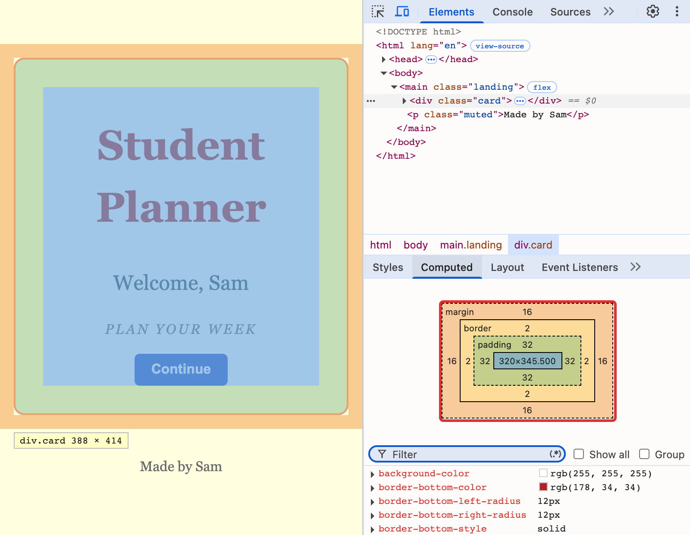

# 2.6: The box

About 30 minutes.

By the end of this lesson your front door will sit inside a card: a white box with room around its words, a red line around it and round corners. You will meet the three layers around a tag's content, **padding**, **border** and **margin**, and you will read them in the browser's developer tools.

## The idea

Every tag on a page is a box, even if you cannot see it. A box has four layers, from the inside out:

```
  +-------------------------------------+
  | margin                              |
  |   +-----------------------------+   |
  |   | border                      |   |
  |   |   +---------------------+   |   |
  |   |   | padding             |   |   |
  |   |   |   +-------------+   |   |   |
  |   |   |   |   content   |   |   |   |
  |   |   |   +-------------+   |   |   |
  |   |   |                     |   |   |
  |   |   +---------------------+   |   |
  |   |                             |   |
  |   +-----------------------------+   |
  |                                     |
  +-------------------------------------+
```

You have met two of the layers already. `padding` was in your `.btn` rule in lesson 2.1, and `margin: 0` was in your `body` rule in lesson 2.5. Both times the lesson said you would meet them properly later. This is that lesson.

New words:

- **content**: the words, or the tags, inside the box.
- **padding**: the space inside the border, between the content and the edge. It has the tag's background colour.
- **border**: a line around the padding.
- **margin**: the space outside the border. It has no colour of its own, so the page shows through it.

## Steps

### 1. Start from last time

Open your project in VS Code and make sure Go Live is running. You will change both files today.

Your homework may have changed your files. Take those changes out before you start, or keep a copy somewhere else, so your files match the listing below.

`index.html` should have this inside the `body`:

```html
<body>
    <main class="landing">
        <h1>Student Planner</h1>
        <p>Welcome, Sam</p>
        <p class="tagline muted">Plan your week</p>
        <button class="btn">Continue</button>
        <p class="muted">Made by Sam</p>
    </main>
</body>
```

`style.css` should end with the `.landing` rule from lesson 2.5.

You should see: the front door in the middle of the window, on the yellow page.

### 2. Put the front door in a box

You need a tag that holds the title, the welcome line, the tagline and the button, and not the last line. `div` is the tag from lesson 1.2: a box with no meaning and no look of its own. In `index.html`, add a `div` around those four lines, and give it a class:

```html
<main class="landing">
    <div class="card">
        <h1>Student Planner</h1>
        <p>Welcome, Sam</p>
        <p class="tagline muted">Plan your week</p>
        <button class="btn">Continue</button>
    </div>
    <p class="muted">Made by Sam</p>
</main>
```

To indent the four lines, select them and press Tab.

The name says how the box looks, not what is in it. `card` can hold a welcome, a list or a form, tomorrow, and a name like `welcome-box` could only ever hold one thing.

Save and look at the browser.

You should see: almost the same page, with the lines closer together. The `gap` from lesson 2.5 now goes between the card and "Made by Sam", not between the lines inside the card. You cannot see the card yet, because a `div` has no look of its own.

### 3. Give it a colour

Add this to the bottom of `style.css`:

```css
.card {
    background-color: white;
}
```

Save and look at the browser.

You should see: a white box around the title, the welcome line, the tagline and the button. It is as big as they are, and no bigger. The title touches the left and right edges. There is space above the title, and none under the button. That is the content, with nothing around it yet.

### 4. Add padding

Add a line to the rule:

```css
.card {
    background-color: white;
    padding: 2rem;
}
```

Save and look at the browser.

You should see: the white box grows by 2rem on every side. The title no longer touches the edges, and the button no longer sits on the bottom edge. Look at the space above the title: it is bigger than the space at the sides. Keep that in mind. Step 7 explains it.

`padding` takes one to four values. Try two. Change the line to:

```css
    padding: 1rem 3rem;
```

The first value is for the top and the bottom, and the second is for the left and the right. Save and look.

You should see: the box is wider and not as tall. Put it back to `padding: 2rem;`.

### 5. Add a border

Add two more lines to the rule:

```css
.card {
    background-color: white;
    padding: 2rem;
    border: 2px solid firebrick;
    border-radius: 12px;
}
```

`border` has three parts: how thick, what kind of line and what colour. `border-radius` rounds the corners, as it did for your button.

Save and look at the browser.

You should see: a thin red line around the box, with round corners. The box is 4 pixels wider and taller than before, because the border sits outside the padding. Try `dashed` in place of `solid`, and `6px` in place of `2px`, and then put them back.

### 6. Add a margin

First look at the page on a phone. Press F12, then the phone-and-tablet icon, or Ctrl+Shift+M (Cmd+Shift+M on a Mac). Choose **iPhone SE** in the drop-down above the page.

You should see: the white box fills the screen from edge to edge. The red line touches the sides. Nothing is wrong, but it looks cramped.

Add a margin to the rule:

```css
.card {
    background-color: white;
    padding: 2rem;
    border: 2px solid firebrick;
    border-radius: 12px;
    margin: 1rem;
}
```

Save and look at the browser.

You should see: a strip of yellow on the left and on the right of the box. The yellow is the page, showing through the margin. Padding is inside the border and has the colour of the box. Margin is outside the border and has no colour.

Now click the phone-and-tablet icon again, to go back to the full page. On a wide window the box does not move. "Made by Sam" sits a little lower, because the margin adds to the gap.

### 7. Read the box in DevTools

Keep the [DevTools cheatsheet](../reference/04-devtools-cheatsheet.md) open. It shows where each part of the panel is.

DevTools is probably still open from step 6. If it is closed, open it with F12 (Cmd+Option+I on a Mac) in Chrome or Edge. Open the tags in the Elements tree with the little triangles, and click `<div class="card">`. Move the mouse along the lines of the tree and watch the page: DevTools paints the layers of the picked tag. The content is blue, the padding is green, the border is yellow and the margin is orange.

Now click **Computed**, next to **Styles**. The box is at the top, with a number for every side:



The numbers are in pixels. They match your rule: `1rem` is 16, `2px` is 2, and `2rem` is 32. The number in the middle is the size of the content. It depends on your window, so yours will not match the picture.

Now open the card with its triangle and click `<h1>`. Look at its box.

You should see: a margin of about 32 at the top and at the bottom of the title (the box may show 32.16), and a dash or a 0 at the sides. A layer with no space shows a dash or a 0. You never wrote that margin. The browser gives `h1` and `p` margins of their own, so the lines are not squeezed together. That is the extra space above the title, in steps 3 and 4. The cheatsheet has a section on reading the box.

### 8. Take the extra margin away

The title has room above it from the padding and the margin together, and the button has only the padding. Take the top margin of the `h1` away. In `style.css`, add one line at the top of the `h1` rule:

```css
h1 {
    margin-top: 0;
    font-size: 3rem;
    color: firebrick;
}
```

`margin-top` sets one side. There are four: `margin-top`, `margin-right`, `margin-bottom` and `margin-left`. `padding` and `border` have four sides in the same way.

Save and look at the browser.

You should see: the same space above the title as at the sides and under the button, 2rem all round. The title may still look a little lower than that, because the line height adds some space above the letters, and the box really has 2rem. The space between the title and the welcome line stays, because that is the bottom margin, and you left it alone.

### 9. Check your files

`index.html` has a card around the front door:

```html
<!DOCTYPE html>
<html lang="en">
<head>
    <meta charset="UTF-8">
    <meta name="viewport" content="width=device-width, initial-scale=1.0">
    <title>Student Planner</title>
    <link rel="stylesheet" href="style.css">
    <link rel="icon" type="image/svg+xml" href="favicon.svg">
</head>
<body>
    <main class="landing">
        <div class="card">
            <h1>Student Planner</h1>
            <p>Welcome, Sam</p>
            <p class="tagline muted">Plan your week</p>
            <button class="btn">Continue</button>
        </div>
        <p class="muted">Made by Sam</p>
    </main>
</body>
</html>
```

`style.css`:

```css
body {
    margin: 0;
    background-color: lightyellow;
    text-align: center;
    color: darkslategray;
    font-family: Georgia, serif;
    line-height: 1.5;
}

h1 {
    margin-top: 0;
    font-size: 3rem;
    color: firebrick;
}

p {
    font-size: 1.5rem;
}

.muted {
    color: dimgray;
    font-size: 1rem;
}

.tagline {
    font-style: italic;
    letter-spacing: 0.15rem;
    text-transform: uppercase;
}

.btn {
    background-color: #2350c8;
    color: white;
    border: none;
    border-radius: 6px;
    padding: 0.6rem 1.2rem;
    font-size: 1rem;
    font-weight: bold;
    cursor: pointer;
    transition: background-color 0.2s;
}

.btn:hover {
    background-color: #1c3f9c;
}

.btn:active {
    background-color: #142f78;
}

.landing {
    display: flex;
    flex-direction: column;
    align-items: center;
    justify-content: center;
    gap: 1rem;
    min-height: 100vh;
}

.card {
    background-color: white;
    padding: 2rem;
    border: 2px solid firebrick;
    border-radius: 12px;
    margin: 1rem;
}
```

### 10. Save it

Save your work with the routine, and push it. The caption is `2.6 The box`. The [git cheatsheet](../reference/01-git-cheatsheet.md) has the commands.

## Recap

- Every tag is a box with four layers, from the inside out: content, padding, border and margin.
- Padding is the space inside the border and has the box's colour. Margin is the space outside the border and has none.
- `padding` and `margin` take one to four values. With two, the first is top and bottom, and the second is left and right. `margin-top` and its relatives set one side.
- `border` has a thickness, a kind of line and a colour: `2px solid firebrick`.
- The browser gives some tags margins of its own, such as `h1` and `p`. DevTools shows them in the Computed tab, and `margin-top: 0` takes one away.
- Name a class for how it looks, such as `card`, and not for what it holds, so you can use it again.

## Homework

Each should take about five minutes.

1. **Do the sum.** In DevTools, pick the card, and click **Computed**. Write down the content width, the padding and the border. Add up the content width, two paddings and two borders. Then move the mouse over the card's line in the Elements tree, and read the size in the label on the page. You know it worked when your sum and the label agree.

2. **The 8 pixels.** In DevTools, pick `<body>` and click **Styles**. Switch off the `margin: 0` line in the `body` rule. Click **Computed** and read the margin, and look at the page: it scrolls a little now, because the page is 100vh tall and the margin adds 8 pixels above and below. Switch the line back on. You know it worked when you have seen the number the browser gives `body`, and you can say what lesson 2.5 took away.

3. **Predict, then check.** Before you try each one, say which sides of the card get space. Then put it in the `.card` rule in place of `padding: 2rem;`, look, and put it back.

   ```
   a   padding: 0 3rem;
   b   padding: 3rem 0 0 0;
   c   padding: 1rem 2rem 3rem 4rem;
   ```

   You know it worked when you got at least two right, and you can say in which order the four values go. Hint: it is clockwise, from the top.

4. **One class, two cards.** Add a second card in `index.html`, between the first card and "Made by Sam":

   ```html
   <div class="card">
       <p>Tip: plan your week on Sunday.</p>
   </div>
   ```

   The words have more room above and below than at the sides, because `p` has a margin of its own. You know it worked when you have two cards, and you wrote no new CSS. When you are done, take the second card out again.

5. **Stretch: a shadow.** Take the `border` line out of `.card`, and add `box-shadow: 0 4px 12px darkgray;` in its place. The values are how far across, how far down, how blurry, and what colour. You know it worked when the card floats above the page. Then say which number makes the shadow fall lower. A shadow takes up no room, so the box does not get bigger. When you are done, take the `box-shadow` line out and put the `border` line back, as in step 9.

## Stuck?

- **Nothing changes.** Check that the name matches in both files: `class="card"` in `index.html` and `.card` in `style.css`, with the dot. Check the curly brackets `{ }` and that every line ends with a semicolon `;`.
- **Only some of the lines work.** A missing semicolon `;` on the line above the first line that fails is the usual cause.
- **The white box is not around everything.** Check that the closing `</div>` is after the button and before the "Made by Sam" line.
- **The space above the title is still bigger.** Check that `margin-top: 0;` is inside the `h1` rule, and not in `.card`.
- **The box touches the edges of the phone.** Check that `margin: 1rem;` is in the `.card` rule.
- **DevTools closed when I pressed F12.** It was already open from step 6, and F12 closes it. Press F12 (Cmd+Option+I on a Mac) again.
- **I cannot find the Computed tab.** Click a tag in the Elements tree first. The tabs are next to **Styles**. If the panel is narrow, they may be behind the `>>` mark.
- **The numbers do not match the picture.** The content size depends on your window. The margin, border and padding should be 16, 2 and 32.
- **The page did not update.** Check that Go Live is running, and that both files are saved. A dot next to a file name in its tab means it is not saved.
