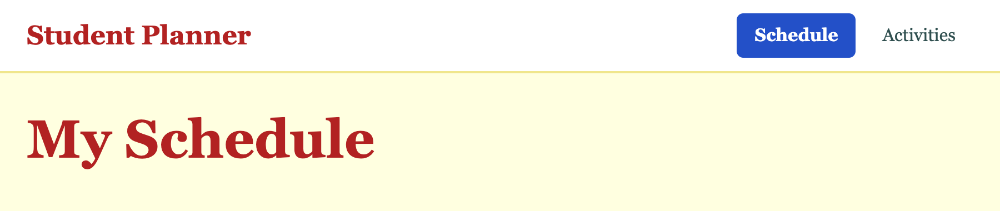

# 3.1: The top bar

About 40 minutes.

By the end of this lesson your app has two pages, Schedule and Activities, with the same top bar on both: the name on the left and two links on the right. You click a link, and you go to the other page. You will meet three new tags, `header`, `nav` and `a`, and write the first classes for the app itself.

## The idea

So far you have one page. The app needs more: a Schedule page, an Activities page and, later, a Homework page. On a website, every page is its own HTML file, and a **link** takes you from one file to another.

A bar across the top of every page lets people move around the app. Three tags make it:

```
  <header>                                     the top of the page
      <a href="index.html">...</a>             a link: the name of the app
      <nav>                                    a group of links for moving around
          <a href="schedule.html">...</a>
          <a href="activities.html">...</a>
      </nav>
  </header>
```

New words:

- **link**: a tag that takes you to another page when you click it. The tag is `a`.
- **href**: the address the link goes to. The name of a file in the same folder, such as `schedule.html`, is enough.
- **header**: the top of a page. **nav**: a group of links for moving around. Like `main` in lesson 1.2, they do not change how the page looks. They say what the part is.

Each page is its own file, so the bar has to be written into each one. You will feel the cost of that at the end of the lesson.

## Steps

### 1. Start from last time

Open your project in VS Code and make sure Go Live is running. You will make two new files and change `style.css`.

`index.html` has the card from lesson 2.6, and `style.css` ends with the `.card` rule.

Your homework may have changed your files. Take those changes out before you start, or keep a copy somewhere else, so your files match the end of the last lesson.

You should see: the front door in a card, in the middle of the window.

### 2. Make the Schedule page

Make a new file called `schedule.html`, next to `index.html`:

```html
<!DOCTYPE html>
<html lang="en">
<head>
    <meta charset="UTF-8">
    <meta name="viewport" content="width=device-width, initial-scale=1.0">
    <title>Schedule</title>
    <link rel="stylesheet" href="style.css">
    <link rel="icon" type="image/svg+xml" href="favicon.svg">
</head>
<body>
    <main class="page">
        <h1>My Schedule</h1>
    </main>
</body>
</html>
```

The `head` is the same as in `index.html`, with a different `title`. Save it. Right-click `schedule.html` in the Explorer on the left of VS Code, and choose **Open with Live Server**.

You should see: "My Schedule" in big red letters, in the middle of the window, right at the top edge. The page uses the same `style.css`, so it has the same yellow background and the same colours.

### 3. Give the page some room

You gave `main` the class `page`, so a rule can point at it. Add this to the bottom of `style.css`:

```css
.page {
    padding: 1.5rem;
}
```

Save and look at the browser.

You should see: the title moves down and in, with 1.5rem of room on every side. It is still in the middle.

### 4. Keep the centring for the front door

The title is in the middle because of `text-align: center` in your `body` rule. You wrote it in lesson 1.2 for the front door. The words on an app page read better from the left, so that rule belongs only to the front door. `text-align` is passed down from a tag to the tags inside it, so put it where it is needed.

In `style.css`, delete the line `text-align: center;` from the `body` rule:

```css
body {
    margin: 0;
    background-color: lightyellow;
    color: darkslategray;
    font-family: Georgia, serif;
    line-height: 1.5;
}
```

Save and look at the browser.

You should see: the title moves to the left, next to the edge of the page.

Now open the front door in the browser. In the address bar, change `schedule.html` to `index.html`.

You should see: the words in the card are at the left. The front door lost its centring. Add the line to the `.landing` rule, as the last line:

```css
.landing {
    display: flex;
    flex-direction: column;
    align-items: center;
    justify-content: center;
    gap: 1rem;
    min-height: 100vh;
    text-align: center;
}
```

Save and look at the browser.

You should see: the front door centred again. Go back to `schedule.html` in the address bar.

### 5. Add the top bar

In `schedule.html`, add a `header` between the `body` tag and the `main` tag:

```html
<body>
    <header>
        <a href="index.html">Student Planner</a>
        <nav>
            <a href="schedule.html">Schedule</a>
            <a href="activities.html">Activities</a>
        </nav>
    </header>
    <main class="page">
        <h1>My Schedule</h1>
    </main>
</body>
```

Save and look at the browser.

You should see: three links in blue with a line under them, above the title. A link to a page you have already opened may be purple instead. The name is on one line, and the two links are under it, side by side. That is the browser's own look for links, as it gave the `h1` its look in lesson 1.2. Click **Schedule**. The page loads again, because the link points at the page you are on. The **Activities** link does not work yet: there is no `activities.html`.

### 6. Give the parts a name

Add a class to each part, so a rule can point at it. Change the tags you have, and do not add a second `header`:

```html
<header class="app-bar">
    <a class="app-name" href="index.html">Student Planner</a>
    <nav class="tabs">
        <a class="tab" href="schedule.html">Schedule</a>
        <a class="tab" href="activities.html">Activities</a>
    </nav>
</header>
```

The names say what each part is: the bar, the name of the app, the group of tabs and one tab.

Save and look at the browser.

You should see: nothing changed. A name by itself changes nothing, as in lesson 2.1.

### 7. Lay out the bar

Add these two rules to the bottom of `style.css`:

```css
.app-bar {
    display: flex;
    justify-content: space-between;
    align-items: center;
    padding: 0.75rem 1.5rem;
    background-color: white;
    border-bottom: 2px solid khaki;
}

.tabs {
    display: flex;
    gap: 0.5rem;
}
```

You know most of these lines from lessons 2.5 and 2.6. `border-bottom` is new, but you know `border`: it is the same line on one side only, the bottom, where `border` draws it on all four. `justify-content: space-between` puts the first child at the start, the last at the end, and shares the space left between them. The bar has two children: the name and the tabs. So the name goes to the left and the tabs go to the right. The tabs are a flex container too, so the two links sit in a row with a gap.

Save and look at the browser.

You should see: a white bar across the top with a line under it. The name is on the left and the two links are on the right. The links are still blue and underlined.

### 8. Style the links

Add these two rules:

```css
.app-name {
    color: firebrick;
    font-size: 1.5rem;
    font-weight: bold;
    text-decoration: none;
}

.tab {
    color: darkslategray;
    padding: 0.5rem 1rem;
    border-radius: 6px;
    text-decoration: none;
}
```

`text-decoration: none` takes the line away. You used `underline` and `line-through` in lesson 2.3. The `color` lines replace the browser's blue, because a rule you write beats the browser's own look.

Save and look at the browser.

You should see: the name in bold red, and the two links in the dark text colour, with no lines under them.

### 9. Hover, and the page you are on

A bar should show where you are. Add two more rules, below `.tab`:

```css
.tab:hover {
    text-decoration: underline;
}

.current {
    background-color: #2350c8;
    color: white;
    font-weight: bold;
}
```

Then, in `schedule.html`, put the name `current` on the link to this page, beside `tab`:

```html
<a class="tab current" href="schedule.html">Schedule</a>
```

Save and look at the browser.

You should see: a blue shape behind **Schedule**, with white words. Move the mouse over **Activities**, and a line appears under it. It does that over the blue one too. `.current` comes after `.tab` in the file, so its colour wins, as in lesson 2.1. The blue is the same blue as your `.btn`.

### 10. Make the Activities page

Make a new file called `activities.html`, next to the other two. It is the same as `schedule.html`, with three changes: the `title`, the heading, and the place of `current`:

```html
<!DOCTYPE html>
<html lang="en">
<head>
    <meta charset="UTF-8">
    <meta name="viewport" content="width=device-width, initial-scale=1.0">
    <title>Activities</title>
    <link rel="stylesheet" href="style.css">
    <link rel="icon" type="image/svg+xml" href="favicon.svg">
</head>
<body>
    <header class="app-bar">
        <a class="app-name" href="index.html">Student Planner</a>
        <nav class="tabs">
            <a class="tab" href="schedule.html">Schedule</a>
            <a class="tab current" href="activities.html">Activities</a>
        </nav>
    </header>
    <main class="page">
        <h1>Activities</h1>
    </main>
</body>
</html>
```

Save it. Go to `schedule.html` in the browser, and click **Activities**. Then click **Schedule**.

You should see: the page changes each time, and the blue shape moves to the link of the page you are on. The bar looks as if it stayed still, but each file has its own copy of it. The shape moves because you put `current` on a different link in each file.



### 11. Look at it on a phone

Open the phone view as in lesson 2.5: press F12, then the phone-and-tablet icon, or Ctrl+Shift+M (Cmd+Shift+M on a Mac). Choose **iPhone SE** in the drop-down.

You should see: the name on two lines, with the tabs next to it. There is not enough room for everything on one line, and nothing is broken. Close the phone view when you are done.

### 12. Check your files

`schedule.html`:

```html
<!DOCTYPE html>
<html lang="en">
<head>
    <meta charset="UTF-8">
    <meta name="viewport" content="width=device-width, initial-scale=1.0">
    <title>Schedule</title>
    <link rel="stylesheet" href="style.css">
    <link rel="icon" type="image/svg+xml" href="favicon.svg">
</head>
<body>
    <header class="app-bar">
        <a class="app-name" href="index.html">Student Planner</a>
        <nav class="tabs">
            <a class="tab current" href="schedule.html">Schedule</a>
            <a class="tab" href="activities.html">Activities</a>
        </nav>
    </header>
    <main class="page">
        <h1>My Schedule</h1>
    </main>
</body>
</html>
```

`activities.html`:

```html
<!DOCTYPE html>
<html lang="en">
<head>
    <meta charset="UTF-8">
    <meta name="viewport" content="width=device-width, initial-scale=1.0">
    <title>Activities</title>
    <link rel="stylesheet" href="style.css">
    <link rel="icon" type="image/svg+xml" href="favicon.svg">
</head>
<body>
    <header class="app-bar">
        <a class="app-name" href="index.html">Student Planner</a>
        <nav class="tabs">
            <a class="tab" href="schedule.html">Schedule</a>
            <a class="tab current" href="activities.html">Activities</a>
        </nav>
    </header>
    <main class="page">
        <h1>Activities</h1>
    </main>
</body>
</html>
```

`style.css`:

```css
body {
    margin: 0;
    background-color: lightyellow;
    color: darkslategray;
    font-family: Georgia, serif;
    line-height: 1.5;
}

h1 {
    margin-top: 0;
    font-size: 3rem;
    color: firebrick;
}

p {
    font-size: 1.5rem;
}

.muted {
    color: dimgray;
    font-size: 1rem;
}

.tagline {
    font-style: italic;
    letter-spacing: 0.15rem;
    text-transform: uppercase;
}

.btn {
    background-color: #2350c8;
    color: white;
    border: none;
    border-radius: 6px;
    padding: 0.6rem 1.2rem;
    font-size: 1rem;
    font-weight: bold;
    cursor: pointer;
    transition: background-color 0.2s;
}

.btn:hover {
    background-color: #1c3f9c;
}

.btn:active {
    background-color: #142f78;
}

.landing {
    display: flex;
    flex-direction: column;
    align-items: center;
    justify-content: center;
    gap: 1rem;
    min-height: 100vh;
    text-align: center;
}

.card {
    background-color: white;
    padding: 2rem;
    border: 2px solid firebrick;
    border-radius: 12px;
    margin: 1rem;
}

.page {
    padding: 1.5rem;
}

.app-bar {
    display: flex;
    justify-content: space-between;
    align-items: center;
    padding: 0.75rem 1.5rem;
    background-color: white;
    border-bottom: 2px solid khaki;
}

.tabs {
    display: flex;
    gap: 0.5rem;
}

.app-name {
    color: firebrick;
    font-size: 1.5rem;
    font-weight: bold;
    text-decoration: none;
}

.tab {
    color: darkslategray;
    padding: 0.5rem 1rem;
    border-radius: 6px;
    text-decoration: none;
}

.tab:hover {
    text-decoration: underline;
}

.current {
    background-color: #2350c8;
    color: white;
    font-weight: bold;
}
```

### 13. Save it

Save your work with the routine, and push it. The caption is `3.1 The top bar`. The [git cheatsheet](../reference/01-git-cheatsheet.md) has the commands.

## Recap

- A page on a website is a file, and a link takes you from one file to another: `<a href="schedule.html">Schedule</a>`.
- `header` is the top of a page, and `nav` is a group of links. They say what the part is. They do not change how it looks.
- The browser gives links their own look: blue, with a line. You change it with `color` and `text-decoration`.
- `justify-content: space-between` puts the first child at one end and the last at the other. It is the way to put a name on the left and a menu on the right.
- Put a style where it is needed. `text-align: center` moved from `body`, which every page uses, to `.landing`, which only the front door uses.
- A class such as `current` marks the page you are on. Two classes on one tag, `tab current`, work as in lesson 2.1: of two rules that disagree, the later one wins.
- The bar is written into every file, so a change to it has to be made in every file.

## Homework

Each should take about five minutes.

1. **A third link.** Add a link to a page that does not exist yet, `<a class="tab" href="homework.html">Homework</a>`, to the bar in both files. Click it. You know it worked when the bar in both files has three links, and the third one gives an error when you click it. Then count the edits you made, and say how many you would make if the app had six pages. On a phone the bar with three links may now be wider than the screen. Take the link out of both files again.

2. **A look of your own.** Change the `.current` rule so the page you are on is marked in another way, such as a coloured line under it: `border-bottom: 3px solid firebrick;` with no background. Change or delete `color: white;` too, or the words are white on the white bar. You know it worked when the mark is clear on both pages, and you changed only `style.css`. Put the `.current` rule back the way it was when you are done.

3. **Predict, then check.** Move the `.current` rule above the `.tab` rule in `style.css`. Before you save, say what the link for the page you are on will look like. Then save and look, and put it back. You know it worked when you can say which of the three lines, `color`, `background-color` and `font-weight`, changed, and why only that one. Hint: lesson 2.1.

## Stuck?

- **The page says "Cannot GET /activities.html".** The file is missing, it has a different name, or it is not in the same folder as `index.html`. Check the spelling in the `href` and the file name.
- **The links are still blue.** Check that each link has its class, and that the rules have the dot: `.tab` and `.app-name`.
- **The name and the links are not on opposite sides.** Check that `justify-content: space-between` is in the `.app-bar` rule, and that `display: flex` is there as well.
- **The blue shape is on both links, or on neither.** Only the link for the page you are on has `current`. Check both files.
- **The blue shape is there, but the words are dark.** The `.current` rule must come after the `.tab` rule in `style.css`.
- **The front door is not centred.** Check that `text-align: center;` is in the `.landing` rule.
- **The title on the Schedule page is still in the middle.** Delete `text-align: center;` from the `body` rule.
- **The page did not update.** Check that Go Live is running, and that every file is saved. A dot next to a file name in its tab means it is not saved.
