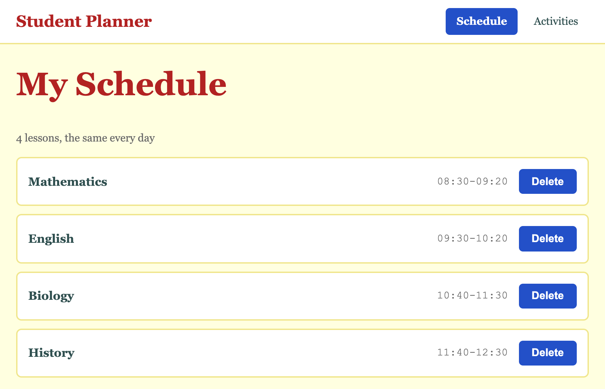

# 3.2: The Schedule page

About 35 minutes.

By the end of this lesson your Schedule page lists four school lessons. Each is a row in its own box: the name on the left, and the time and a Delete button on the right. You will meet the tags for a list, `ul` and `li`, and the tag `span`. You will also meet `flex: 1`, which makes one child fill a row.

## The idea

A schedule is a list of things that look alike: a school lesson, then another, then another. HTML has tags for that. `ul` is a list, and every `li` inside it is one item:

```
  <ul>                                             the list
      <li>Mathematics</li>                         one item
      <li>English</li>                             another item
  </ul>
```

Each item of your list will be a row with three parts: the name of the subject, its time, and a button:

```
  +---------------------------------------------------------+
  | Mathematics                        08:30-09:20  [Delete] |
  +---------------------------------------------------------+
    the name                           the time     the button
```

In this lesson every class is named for what it holds on this page: `courses` for the list, `course` for one row, `course-name` and `course-time` for its parts. That is how most people start.

New words:

- **list**: a group of items that belong together. `ul` is the list, and `li` is one item in it.
- **span**: a piece of text inside a line. It has no look of its own. You use it to give a part of a line a class.
- **flex: 1**: in a flex container, this child takes all the space that is left over in the row.

## Steps

### 1. Start from last time

Open your project in VS Code and make sure Go Live is running. You will change `schedule.html` and `style.css`.

`schedule.html` has the top bar and the title `My Schedule`. `style.css` ends with the `.current` rule.

Your homework may have changed your files. Take those changes out before you start, or keep a copy somewhere else, so your files match the end of the last lesson.

You should see: the top bar with the blue shape behind **Schedule**, and the title under it.

### 2. A list

In `schedule.html`, add a line of text and a list under the title:

```html
<main class="page">
    <h1>My Schedule</h1>
    <p class="muted">4 lessons, the same every day</p>
    <ul>
        <li>Mathematics</li>
        <li>English</li>
        <li>Biology</li>
        <li>History</li>
    </ul>
</main>
```

Save and look at the browser.

You should see: a small grey line, and four items, one under the other. Each has a bullet in front of it, and the list is indented. That is the browser's own look for a list.

### 3. Take away the bullets

You do not want bullets or the indent in this app, on any list. Add a rule for the tag `ul` to the bottom of `style.css`:

```css
ul {
    list-style: none;
    margin: 0;
    padding: 0;
}
```

`list-style: none` takes away the bullets. The browser makes the indent with padding, as it made the space around `h1` with a margin in lesson 2.6, so `margin: 0` and `padding: 0` take both away.

Save and look at the browser.

You should see: the four names as plain lines, level with the title at the left, with no bullets.

### 4. Add the time and the button

Each row needs three parts. Put each part in its own tag, inside the `li`. The name and the time are text, so use `span` for them. The button is a `button`, as on your front door. Do this for all four items:

```html
<ul>
    <li>
        <span>Mathematics</span>
        <span>08:30-09:20</span>
        <button class="btn">Delete</button>
    </li>
    <li>
        <span>English</span>
        <span>09:30-10:20</span>
        <button class="btn">Delete</button>
    </li>
    <li>
        <span>Biology</span>
        <span>10:40-11:30</span>
        <button class="btn">Delete</button>
    </li>
    <li>
        <span>History</span>
        <span>11:40-12:30</span>
        <button class="btn">Delete</button>
    </li>
</ul>
```

Save and look at the browser.

You should see: four lines, each with the name, the time and a blue button next to each other. The button does nothing yet.

### 5. Give the parts a name

Add classes, named for what each part is on this page. Here is the first item:

```html
<ul class="courses">
    <li class="course">
        <span class="course-name">Mathematics</span>
        <span class="course-time">08:30-09:20</span>
        <button class="btn">Delete</button>
    </li>
```

Give the other three items the same classes. The button keeps `btn`.

Save and look at the browser.

You should see: nothing changed. A name by itself changes nothing.

### 6. Space the rows

Add this to the bottom of `style.css`:

```css
.courses {
    display: flex;
    flex-direction: column;
    gap: 0.75rem;
}
```

Save and look at the browser.

You should see: the four items with a little space between them. The list is a flex column, and `gap` is the space between its children, as in lesson 2.5.

### 7. Make each row a box

Add a rule for one row:

```css
.course {
    display: flex;
    align-items: center;
    gap: 1rem;
    padding: 1rem;
    background-color: white;
    border: 2px solid khaki;
    border-radius: 8px;
}
```

The first three lines arrange what is inside the row: a flex container with the default direction, a row. `align-items: center` puts the three parts in the middle of the row's height, up and down, because the button is taller than the words. The last four lines are the card from lesson 2.6: padding, a colour, a border and round corners.

Save and look at the browser.

You should see: each item is a white box with a thin line and round corners. Inside, the name, the time and the button are in a row, close together at the left.

### 8. Push the time and the button to the right

Add a rule for the name:

```css
.course-name {
    flex: 1;
}
```

`flex: 1` makes the name take all the space that is left over in the row. It grows until the row is full, so the time and the button are pushed to the right.

Save and look at the browser.

You should see: the names at the left of each box, and the times and the buttons at the right.

### 9. Style the words

Change the `.course-name` rule, and add a rule for the time:

```css
.course-name {
    flex: 1;
    font-size: 1.1rem;
    font-weight: bold;
}

.course-time {
    color: dimgray;
    font-family: "Courier New", monospace;
}
```

A monospace font gives every letter the same width, so the times line up.

Save and look at the browser.

You should see: the names in bold, and the times in grey typewriter letters, lined up one under the other.



### 10. Make the window wide and narrow

Drag the edge of the browser window to make it wider, or zoom out with Ctrl and **-** (Cmd and **-** on a Mac).

You should see: the rows stretch across the whole window. On a wide screen the name and the Delete button end up very far apart. You will fix that in lesson 3.6.

Now open the phone view, as in lesson 3.1.

You should see: the name in the top bar on two lines, as in lesson 3.1, and the time in each row split into two lines, at the hyphen. The rows stay inside the page. Close the phone view and press Ctrl+0 (Cmd+0) when you are done.

### 11. Check your files

`schedule.html`:

```html
<!DOCTYPE html>
<html lang="en">
<head>
    <meta charset="UTF-8">
    <meta name="viewport" content="width=device-width, initial-scale=1.0">
    <title>Schedule</title>
    <link rel="stylesheet" href="style.css">
    <link rel="icon" type="image/svg+xml" href="favicon.svg">
</head>
<body>
    <header class="app-bar">
        <a class="app-name" href="index.html">Student Planner</a>
        <nav class="tabs">
            <a class="tab current" href="schedule.html">Schedule</a>
            <a class="tab" href="activities.html">Activities</a>
        </nav>
    </header>
    <main class="page">
        <h1>My Schedule</h1>
        <p class="muted">4 lessons, the same every day</p>
        <ul class="courses">
            <li class="course">
                <span class="course-name">Mathematics</span>
                <span class="course-time">08:30-09:20</span>
                <button class="btn">Delete</button>
            </li>
            <li class="course">
                <span class="course-name">English</span>
                <span class="course-time">09:30-10:20</span>
                <button class="btn">Delete</button>
            </li>
            <li class="course">
                <span class="course-name">Biology</span>
                <span class="course-time">10:40-11:30</span>
                <button class="btn">Delete</button>
            </li>
            <li class="course">
                <span class="course-name">History</span>
                <span class="course-time">11:40-12:30</span>
                <button class="btn">Delete</button>
            </li>
        </ul>
    </main>
</body>
</html>
```

`style.css`:

```css
body {
    margin: 0;
    background-color: lightyellow;
    color: darkslategray;
    font-family: Georgia, serif;
    line-height: 1.5;
}

h1 {
    margin-top: 0;
    font-size: 3rem;
    color: firebrick;
}

p {
    font-size: 1.5rem;
}

.muted {
    color: dimgray;
    font-size: 1rem;
}

.tagline {
    font-style: italic;
    letter-spacing: 0.15rem;
    text-transform: uppercase;
}

.btn {
    background-color: #2350c8;
    color: white;
    border: none;
    border-radius: 6px;
    padding: 0.6rem 1.2rem;
    font-size: 1rem;
    font-weight: bold;
    cursor: pointer;
    transition: background-color 0.2s;
}

.btn:hover {
    background-color: #1c3f9c;
}

.btn:active {
    background-color: #142f78;
}

.landing {
    display: flex;
    flex-direction: column;
    align-items: center;
    justify-content: center;
    gap: 1rem;
    min-height: 100vh;
    text-align: center;
}

.card {
    background-color: white;
    padding: 2rem;
    border: 2px solid firebrick;
    border-radius: 12px;
    margin: 1rem;
}

.page {
    padding: 1.5rem;
}

.app-bar {
    display: flex;
    justify-content: space-between;
    align-items: center;
    padding: 0.75rem 1.5rem;
    background-color: white;
    border-bottom: 2px solid khaki;
}

.tabs {
    display: flex;
    gap: 0.5rem;
}

.app-name {
    color: firebrick;
    font-size: 1.5rem;
    font-weight: bold;
    text-decoration: none;
}

.tab {
    color: darkslategray;
    padding: 0.5rem 1rem;
    border-radius: 6px;
    text-decoration: none;
}

.tab:hover {
    text-decoration: underline;
}

.current {
    background-color: #2350c8;
    color: white;
    font-weight: bold;
}

ul {
    list-style: none;
    margin: 0;
    padding: 0;
}

.courses {
    display: flex;
    flex-direction: column;
    gap: 0.75rem;
}

.course {
    display: flex;
    align-items: center;
    gap: 1rem;
    padding: 1rem;
    background-color: white;
    border: 2px solid khaki;
    border-radius: 8px;
}

.course-name {
    flex: 1;
    font-size: 1.1rem;
    font-weight: bold;
}

.course-time {
    color: dimgray;
    font-family: "Courier New", monospace;
}
```

### 12. Save it

Save your work with the routine, and push it. The caption is `3.2 The Schedule page`. The [git cheatsheet](../reference/01-git-cheatsheet.md) has the commands.

## Recap

- A list of alike things is a `ul`, with one `li` for each item.
- The browser gives a list bullets and an indent. `list-style: none`, `margin: 0` and `padding: 0` take them away.
- `span` is a piece of text with no look of its own. You use it to give part of a line a class.
- A row is a flex container: its children go side by side. `align-items: center` puts them in the middle of the row's height.
- `flex: 1` on one child makes it take all the space that is left in the row, and pushes the others to the end.
- Each class here is named for what it holds on this page: `courses`, `course`, `course-name` and `course-time`.

## Homework

Each should take about five minutes.

1. **Another subject.** Add a fifth subject to the list, Geography at 12:40-13:30, and change the line under the title to say 5 lessons. You know it worked when the new row looks like the others, and you wrote no CSS. Take the row out again when you are done, and change the line back to 4 lessons.

2. **Switch off, switch on.** Open the [DevTools cheatsheet](../reference/04-devtools-cheatsheet.md). Pick one `<li class="course">`. Switch one line of its rule off, look, and switch it back on before you do the next. The lines are `display`, `align-items` and `gap`. Then pick a `<span class="course-name">` and switch off `flex: 1`. For each line, write one sentence about what the row does without it. All four rows change, because they share the rule. You know it worked when you have four sentences and the page looks normal at the end.

3. **Rows with lines.** Change the `.course` rule so the rows are not boxes, only lines between them: take away the background and the round corners, and keep only a line under each row. You know it worked when the four rows are separated by thin lines. Hint: delete the `background-color` and `border-radius` lines, and change `border` to `border-bottom`. Put it back when you are done.

4. **Stretch: the lesson that is on now.** Add a class `now` to one row: `<li class="course now">`. Write a rule `.now { border-color: #2350c8; }` at the bottom of `style.css`. You know it worked when that row has a blue border. Then move the `.now` rule above the `.course` rule, and say what happens and why. Hint: lesson 2.1. Take the `.now` rule and the class `now` out again when you are done.

## Stuck?

- **The bullets are still there.** Check that the rule is `ul { ... }`, with no dot, and that it has `list-style: none;`.
- **The three parts are squeezed together at the left.** Check that `display: flex;` is in the `.course` rule, and that the name `course` matches in both files.
- **The time and the button are not at the right.** Check that `flex: 1;` is in the `.course-name` rule, and that the name is on a `span` with that class.
- **The times do not line up.** Check the line `font-family: "Courier New", monospace;`, with a comma between the two names.
- **The rows touch each other.** Check that `.courses` has `display: flex;`, `flex-direction: column;` and `gap`, and that the list has `class="courses"`.
- **The first row looks different.** Check the opening tags: every item has `class="course"`, and the list has `class="courses"`, with an s.
- **The page did not update.** Check that Go Live is running, and that both files are saved. A dot next to a file name in its tab means it is not saved.
