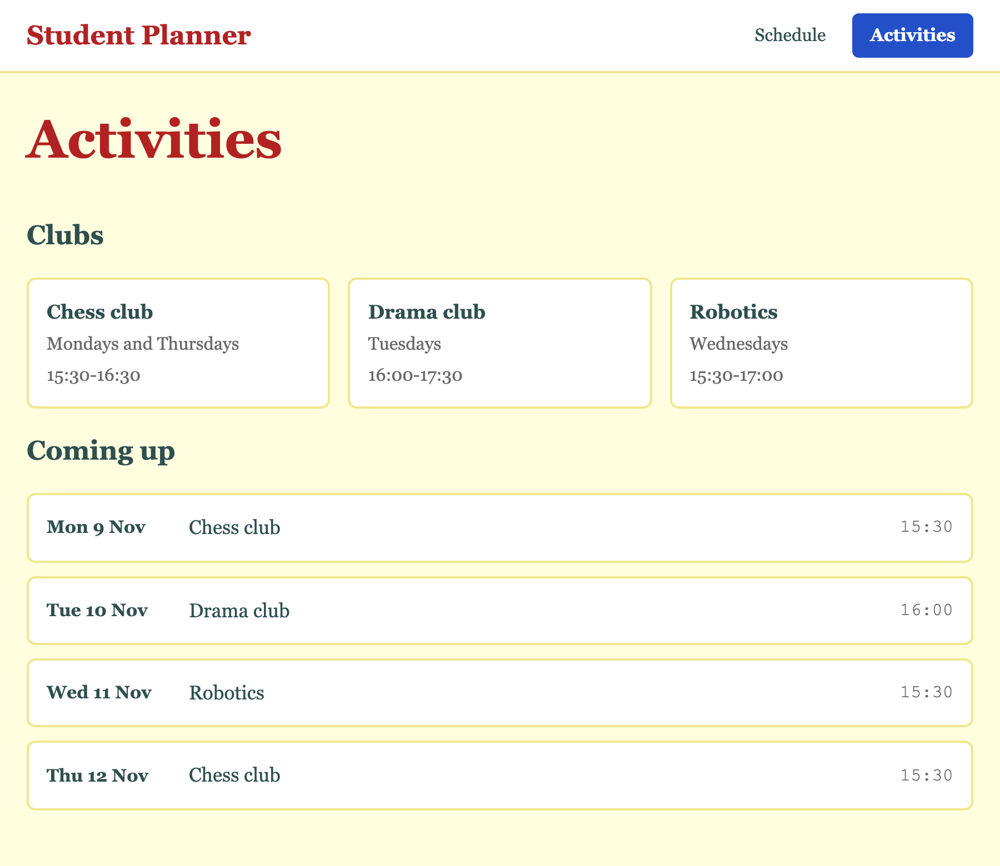

# 3.3: The Activities page

About 35 minutes.

By the end of this lesson your Activities page has two parts: the clubs as cards that re-flow when the window changes size, and a list of the next sessions. You will meet the heading tag `h2` and a new way to arrange things, a **grid**. The second part you have already written once, in a different page.

## The idea

The Activities page shows two things:

```
  Clubs                                          the clubs, as cards, side by side
  +------------+ +------------+ +------------+
  | Chess club | | Drama club | | Robotics   |
  +------------+ +------------+ +------------+

  Coming up                                      the next sessions, one under the other
  +--------------------------------------------+
  | Mon 9 Nov    Chess club              15:30 |
  +--------------------------------------------+
```

The sessions are rows in a column, like the rows on the Schedule page. The cards are new. A flex container puts its children in one line, a row or a column. For cards you want many to a line, and a new line when there is no room. A flex container can do that too, if you let it wrap with `flex-wrap: wrap`, but then each line sizes its own cards, and the cards in one line do not line up with the cards in the next. A **grid** keeps one set of columns for all of them. It has rows and columns, and you say how wide the columns are.

Every class is named for what it holds again: `activities` and `activity` for the clubs, `upcoming` and `session` for the sessions.

New words:

- **h2**: a heading one level below `h1`. The browser makes it smaller. There are `h2` to `h6`.
- **grid**: a tag with `display: grid`. Its children are placed in rows and columns.
- **fr**: one share of the space that is left. `1fr 1fr 1fr` is three columns of the same width.
- **repeat()**: writes a column size several times. `repeat(3, 1fr)` is the same as `1fr 1fr 1fr`.
- **minmax()**: a size with a smallest and a largest value. `minmax(14rem, 1fr)` is at least 14rem, and at most one share of the space.

## Steps

### 1. Start from last time

Open your project in VS Code and make sure Go Live is running. You will change `activities.html` and `style.css`.

`activities.html` has the top bar and the title `Activities`. `style.css` ends with the `.course-time` rule from lesson 3.2.

Your homework may have changed your files. Take those changes out before you start, or keep a copy somewhere else, so your files match the end of the last lesson.

You should see: the top bar with the blue shape behind **Activities**, and the title under it.

### 2. The clubs

In `activities.html`, add a heading and a list of three clubs inside `main`, under the title. Each club has a name, the days and the time, in `span` tags:

```html
<main class="page">
    <h1>Activities</h1>
    <h2>Clubs</h2>
    <ul>
        <li>
            <span>Chess club</span>
            <span>Mondays and Thursdays</span>
            <span>15:30-16:30</span>
        </li>
        <li>
            <span>Drama club</span>
            <span>Tuesdays</span>
            <span>16:00-17:30</span>
        </li>
        <li>
            <span>Robotics</span>
            <span>Wednesdays</span>
            <span>15:30-17:00</span>
        </li>
    </ul>
</main>
```

Save and look at the browser.

You should see: a heading `Clubs`, smaller than the title and in the dark text colour of `body`, because only `h1` has a red rule. Under it are three lines. Each line has the name, the days and the time next to each other. The list has no bullets, because your `ul` rule from lesson 3.2 is for every list.

### 3. Give the parts a name

Add classes, named for what each part is on this page. Here is the first club:

```html
<ul class="activities">
    <li class="activity">
        <span class="activity-name">Chess club</span>
        <span class="activity-days muted">Mondays and Thursdays</span>
        <span class="activity-time muted">15:30-16:30</span>
    </li>
```

Give the other two clubs the same classes. The days and the time have two classes each, as in lesson 2.1: their own name, and `muted`, which gives them grey letters.

Save and look at the browser.

You should see: the days and the times in grey letters. The rest is the same.

### 4. Make each club a card

Add these two rules to the bottom of `style.css`:

```css
.activity {
    display: flex;
    flex-direction: column;
    gap: 0.25rem;
    padding: 1rem;
    background-color: white;
    border: 2px solid khaki;
    border-radius: 8px;
}

.activity-name {
    font-size: 1.1rem;
    font-weight: bold;
}
```

The first three lines stack what is inside the card in a column. The last four are the card look again: padding, a colour, a border and round corners.

Save and look at the browser.

You should see: three white boxes, one under the other. In each, the name is bold, and the days and the time are grey under it. The boxes touch, because the list does not space them yet.

### 5. Put the cards in columns

The list needs to arrange its children, the three cards. Add a rule for it:

```css
.activities {
    display: grid;
    grid-template-columns: repeat(3, 1fr);
    gap: 1rem;
}
```

`display: grid` makes the list a grid. `grid-template-columns` says how many columns, and how wide. `repeat(3, 1fr)` means three columns, each one share of the space, so all three have the same width. `gap` is the space between the cells, as in a flex container.

`repeat` has two arguments, the two things inside its brackets. The first says how many times, and the second says what to repeat:

```
  repeat( 3 , 1fr )
          |    |
          |    +-- what to repeat: a column that is one share wide
          +------- how many times
```

Save and look at the browser.

You should see: the three cards side by side, with the same width, and a gap between them. On a phone they get too narrow. The next step fixes that.

### 6. Let the number of columns change

Three columns is too many for a phone. Change the line `grid-template-columns` to this:

```css
    grid-template-columns: repeat(auto-fit, minmax(14rem, 1fr));
```

`minmax(14rem, 1fr)` says a column is never narrower than 14rem, which is 224 pixels, and never wider than its share. `auto-fit` says to make as many columns as fit. The window decides.

In `repeat(auto-fit, minmax(14rem, 1fr))` the first argument is not a number. It is `auto-fit`, which means "as many times as fit". The second argument is what to repeat: a column between 14rem and one share. And `minmax` has two arguments as well: the smallest size, then the largest.

Here is how the browser works it out. Say your window is 900 pixels wide. The page padding takes 48, so the cards have 852. Four columns of 224 pixels, with the gaps, need 944 pixels, which is too much. Three need 704 pixels, so the browser makes three, and shares the 148 pixels that are left. Each column is 273 pixels wide. On a phone only one column fits.

Save and look at the browser. Then drag the edge of the window to make it narrower and wider, or open the phone view as in lesson 3.1.

You should see: three cards in a row on a wide window. As the window gets narrower the cards re-flow: two in a row, then one in a row, each as wide as the page. Nothing is cut off.

### 7. Coming up

Inside `main`, under the list of clubs, add a second heading and a list of the next four sessions. Each has the day, the name and the time. The classes are named for what they hold:

```html
<h2>Coming up</h2>
<ul class="upcoming">
    <li class="session">
        <span class="session-day">Mon 9 Nov</span>
        <span class="session-name">Chess club</span>
        <span class="session-time">15:30</span>
    </li>
    <li class="session">
        <span class="session-day">Tue 10 Nov</span>
        <span class="session-name">Drama club</span>
        <span class="session-time">16:00</span>
    </li>
    <li class="session">
        <span class="session-day">Wed 11 Nov</span>
        <span class="session-name">Robotics</span>
        <span class="session-time">15:30</span>
    </li>
    <li class="session">
        <span class="session-day">Thu 12 Nov</span>
        <span class="session-name">Chess club</span>
        <span class="session-time">15:30</span>
    </li>
</ul>
```

Save and look at the browser.

You should see: a heading `Coming up` and four lines, each with a day, a name and a time next to each other.

### 8. Style the sessions

This list is a column of rows, like the one on the Schedule page. Open `style.css`, copy the `.courses` rule and the `.course` rule, and paste them at the bottom. Change the names to `.upcoming` and `.session`. Then add rules for the parts. When you are done, you have these rules for the sessions:

```css
.upcoming {
    display: flex;
    flex-direction: column;
    gap: 0.75rem;
}

.session {
    display: flex;
    align-items: center;
    gap: 1rem;
    padding: 1rem;
    background-color: white;
    border: 2px solid khaki;
    border-radius: 8px;
}

.session-day {
    width: 7rem;
    font-weight: bold;
}

.session-name {
    flex: 1;
    font-size: 1.1rem;
}

.session-time {
    color: dimgray;
    font-family: "Courier New", monospace;
}
```

`width: 7rem` gives every day the same width, so the names start in the same place. It works because `.session-day` is an item of a flex container, the `.session` row. On a plain `span`, which is a piece of a line, `width` does nothing. `flex: 1` on the name pushes the time to the right, as on the Schedule page.

Save and look at the browser.

You should see: four white boxes, each with the day in bold, the name, and the time at the right edge in grey typewriter letters. The page looks like the Schedule page.



### 9. Look at what you wrote

Open `style.css` and press Ctrl+F (Cmd+F on a Mac). Search for `display: flex`.

You should see: `of 8` in the search box. The number before it depends on where your cursor is. Your CSS says "make this a flex container" in eight places: the front door, the top bar, the tabs, the schedule list, a row of the schedule, a club card, the list of sessions, and a session row. Search for `border: 2px solid khaki`: it is there three times. The card look is written out three times, once for each kind of box.

Nothing is wrong. The page works. But look at the rules for `.courses` and `.upcoming`, and at `.course` and `.session`. They are the same, apart from the name. Lesson 3.4 is about that. Close the search with Escape.

### 10. Check your files

`activities.html`:

```html
<!DOCTYPE html>
<html lang="en">
<head>
    <meta charset="UTF-8">
    <meta name="viewport" content="width=device-width, initial-scale=1.0">
    <title>Activities</title>
    <link rel="stylesheet" href="style.css">
    <link rel="icon" type="image/svg+xml" href="favicon.svg">
</head>
<body>
    <header class="app-bar">
        <a class="app-name" href="index.html">Student Planner</a>
        <nav class="tabs">
            <a class="tab" href="schedule.html">Schedule</a>
            <a class="tab current" href="activities.html">Activities</a>
        </nav>
    </header>
    <main class="page">
        <h1>Activities</h1>
        <h2>Clubs</h2>
        <ul class="activities">
            <li class="activity">
                <span class="activity-name">Chess club</span>
                <span class="activity-days muted">Mondays and Thursdays</span>
                <span class="activity-time muted">15:30-16:30</span>
            </li>
            <li class="activity">
                <span class="activity-name">Drama club</span>
                <span class="activity-days muted">Tuesdays</span>
                <span class="activity-time muted">16:00-17:30</span>
            </li>
            <li class="activity">
                <span class="activity-name">Robotics</span>
                <span class="activity-days muted">Wednesdays</span>
                <span class="activity-time muted">15:30-17:00</span>
            </li>
        </ul>
        <h2>Coming up</h2>
        <ul class="upcoming">
            <li class="session">
                <span class="session-day">Mon 9 Nov</span>
                <span class="session-name">Chess club</span>
                <span class="session-time">15:30</span>
            </li>
            <li class="session">
                <span class="session-day">Tue 10 Nov</span>
                <span class="session-name">Drama club</span>
                <span class="session-time">16:00</span>
            </li>
            <li class="session">
                <span class="session-day">Wed 11 Nov</span>
                <span class="session-name">Robotics</span>
                <span class="session-time">15:30</span>
            </li>
            <li class="session">
                <span class="session-day">Thu 12 Nov</span>
                <span class="session-name">Chess club</span>
                <span class="session-time">15:30</span>
            </li>
        </ul>
    </main>
</body>
</html>
```

`style.css`:

```css
body {
    margin: 0;
    background-color: lightyellow;
    color: darkslategray;
    font-family: Georgia, serif;
    line-height: 1.5;
}

h1 {
    margin-top: 0;
    font-size: 3rem;
    color: firebrick;
}

p {
    font-size: 1.5rem;
}

.muted {
    color: dimgray;
    font-size: 1rem;
}

.tagline {
    font-style: italic;
    letter-spacing: 0.15rem;
    text-transform: uppercase;
}

.btn {
    background-color: #2350c8;
    color: white;
    border: none;
    border-radius: 6px;
    padding: 0.6rem 1.2rem;
    font-size: 1rem;
    font-weight: bold;
    cursor: pointer;
    transition: background-color 0.2s;
}

.btn:hover {
    background-color: #1c3f9c;
}

.btn:active {
    background-color: #142f78;
}

.landing {
    display: flex;
    flex-direction: column;
    align-items: center;
    justify-content: center;
    gap: 1rem;
    min-height: 100vh;
    text-align: center;
}

.card {
    background-color: white;
    padding: 2rem;
    border: 2px solid firebrick;
    border-radius: 12px;
    margin: 1rem;
}

.page {
    padding: 1.5rem;
}

.app-bar {
    display: flex;
    justify-content: space-between;
    align-items: center;
    padding: 0.75rem 1.5rem;
    background-color: white;
    border-bottom: 2px solid khaki;
}

.tabs {
    display: flex;
    gap: 0.5rem;
}

.app-name {
    color: firebrick;
    font-size: 1.5rem;
    font-weight: bold;
    text-decoration: none;
}

.tab {
    color: darkslategray;
    padding: 0.5rem 1rem;
    border-radius: 6px;
    text-decoration: none;
}

.tab:hover {
    text-decoration: underline;
}

.current {
    background-color: #2350c8;
    color: white;
    font-weight: bold;
}

ul {
    list-style: none;
    margin: 0;
    padding: 0;
}

.courses {
    display: flex;
    flex-direction: column;
    gap: 0.75rem;
}

.course {
    display: flex;
    align-items: center;
    gap: 1rem;
    padding: 1rem;
    background-color: white;
    border: 2px solid khaki;
    border-radius: 8px;
}

.course-name {
    flex: 1;
    font-size: 1.1rem;
    font-weight: bold;
}

.course-time {
    color: dimgray;
    font-family: "Courier New", monospace;
}

.activity {
    display: flex;
    flex-direction: column;
    gap: 0.25rem;
    padding: 1rem;
    background-color: white;
    border: 2px solid khaki;
    border-radius: 8px;
}

.activity-name {
    font-size: 1.1rem;
    font-weight: bold;
}

.activities {
    display: grid;
    grid-template-columns: repeat(auto-fit, minmax(14rem, 1fr));
    gap: 1rem;
}

.upcoming {
    display: flex;
    flex-direction: column;
    gap: 0.75rem;
}

.session {
    display: flex;
    align-items: center;
    gap: 1rem;
    padding: 1rem;
    background-color: white;
    border: 2px solid khaki;
    border-radius: 8px;
}

.session-day {
    width: 7rem;
    font-weight: bold;
}

.session-name {
    flex: 1;
    font-size: 1.1rem;
}

.session-time {
    color: dimgray;
    font-family: "Courier New", monospace;
}
```

### 11. Save it

Save your work with the routine, and push it. The caption is `3.3 The Activities page`. The [git cheatsheet](../reference/01-git-cheatsheet.md) has the commands.

## Recap

- `h2` is a heading one level below `h1`. Use the next level down for each part of a page.
- A grid arranges its children in rows and columns. `display: grid` makes one, and `grid-template-columns` says how many columns and how wide.
- `1fr` is one share of the free space. `repeat(3, 1fr)` is three equal columns.
- `repeat(auto-fit, minmax(14rem, 1fr))` is as many columns as fit, none narrower than 14rem. The cards re-flow when the window changes.
- The [Flexbox and grid cheatsheet](../reference/05-flexbox-and-grid-cheatsheet.md) has the other grid values and some patterns.
- A list that looks like another list is a place to reuse what you wrote. Here you copied the rules and changed the names.
- Every class so far is named for what it holds on this page. That works, but it has a cost: the same few lines are written again and again under different names.

## Homework

Each should take about five minutes.

1. **A fourth club.** Add a fourth club to the list, such as Choir on Fridays, 13:00-13:45. You know it worked when it is a card like the others, and you wrote no CSS. Say whether it fits in the first row in your window. Take the club out again when you are done.

2. **Predict, then check.** Take the fourth club out first, if you added it. Before you try each one, say how many columns the clubs will have in your window. Then put it in the `grid-template-columns` line in place of the one you have, look, and put it back.

   ```
   a   repeat(auto-fit, minmax(8rem, 1fr))
   b   repeat(auto-fit, minmax(30rem, 1fr))
   c   repeat(2, 1fr)
   ```

   You know it worked when you got at least two right. Hint for (a): `auto-fit` shares the room between the cards you have, and does not leave empty columns. Hint for (b): 30rem is wider than a phone screen, so on a phone the page scrolls sideways. A column never gets narrower than its first number.

3. **Use a class again.** Add a heading `Last week` and a second list under the sessions, with `class="upcoming"` and two items with `class="session"`. You know it worked when the second list looks like the first, and you wrote no CSS. Then ask yourself if `upcoming` is a good name for sessions that have already happened. Take the heading and the second list out again before lesson 3.4, which deletes the `.upcoming` rule.

## Stuck?

- **The cards are in one column.** Check that the list has `class="activities"` and that the rule has `display: grid;`.
- **The cards are in one column at every width.** Check the line: `grid-template-columns: repeat(auto-fit, minmax(14rem, 1fr));`, with the brackets in pairs and the commas. A missing bracket `)` can also spoil the rules under it, so if the sessions lost their style too, look for it.
- **The cards touch each other.** Check that `gap: 1rem;` is in the `.activities` rule.
- **The days are not the same width, and the names do not line up.** Check that `.session-day` has `width: 7rem;`, that the `li` has `class="session"`, and that the `.session` rule has `display: flex;`. `width` does nothing on a `span` that is not inside a flex container.
- **The times are not at the right.** Check that `flex: 1;` is in the `.session-name` rule.
- **A list has bullets.** Check that your `ul` rule from lesson 3.2 is still in `style.css`.
- **The page did not update.** Check that Go Live is running, and that both files are saved. A dot next to a file name in its tab means it is not saved.
