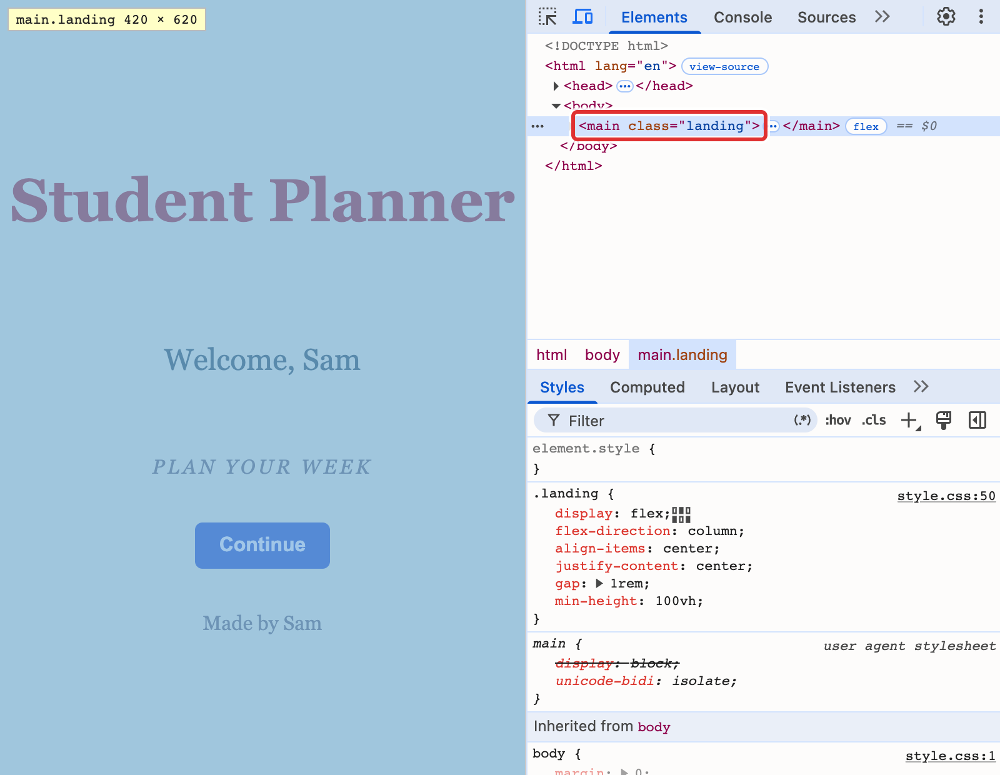
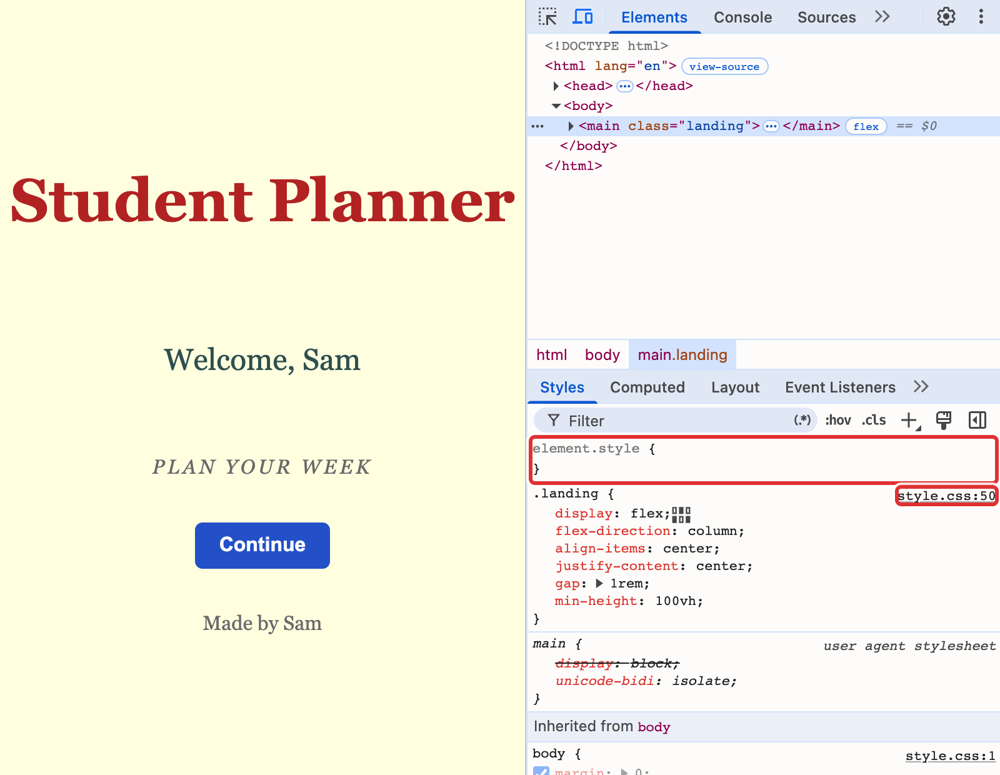
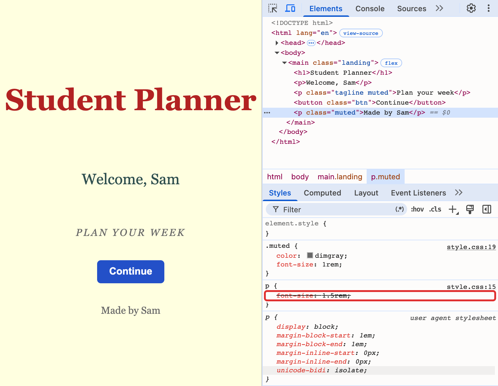
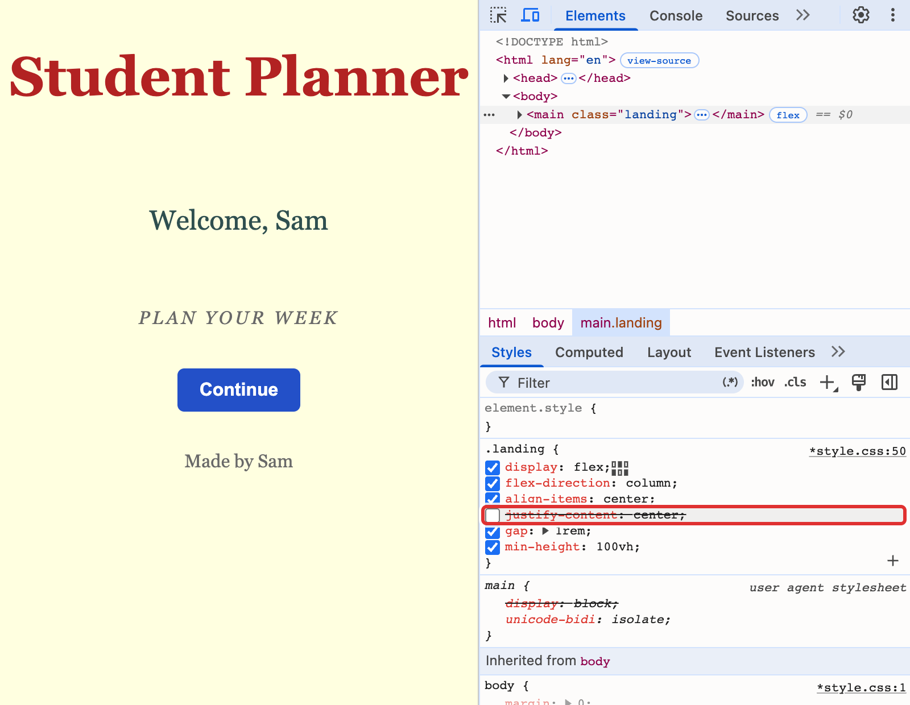
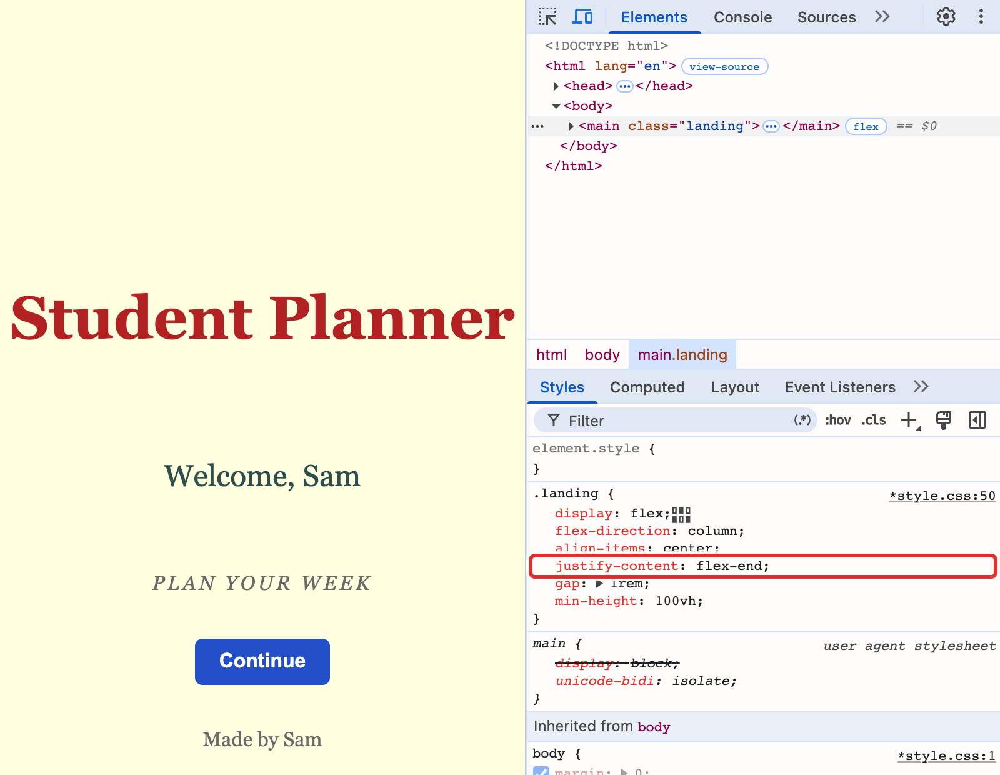
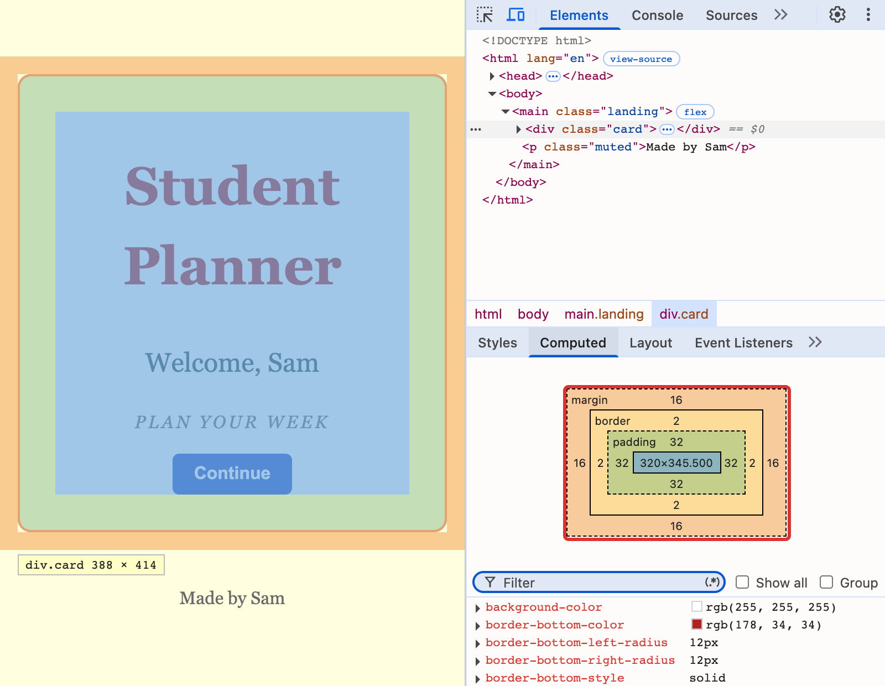
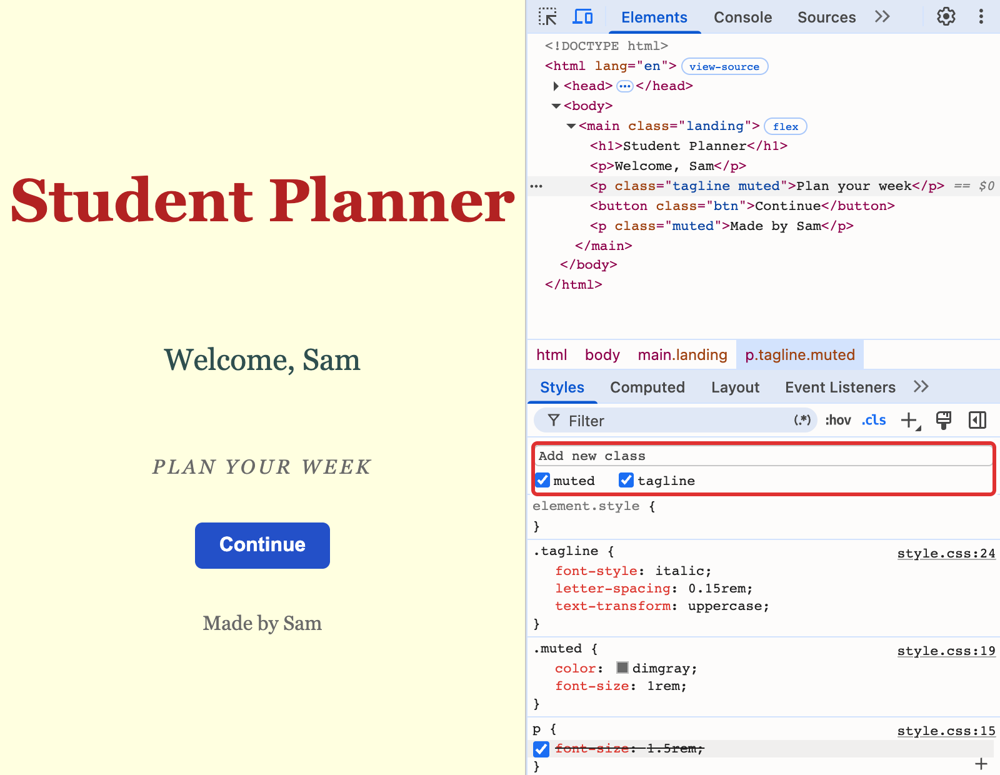
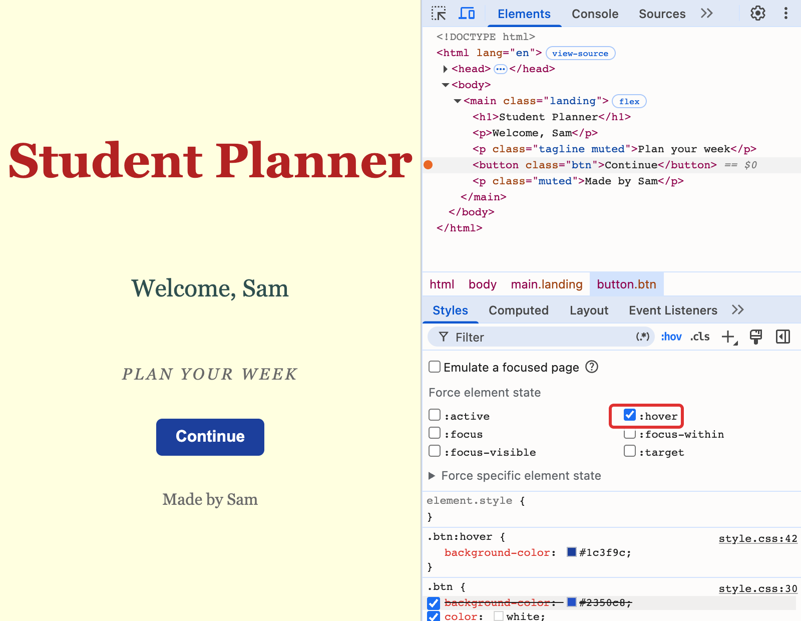

# DevTools cheatsheet

DevTools is the set of tools built into the browser. It shows the HTML and the CSS the browser is using right now, and lets you change them to try an idea, so you can see the result at once. Use Chrome or Edge. The pictures are from Chrome, and Edge looks a little different but has the same parts. The red boxes are not part of DevTools. They show where to look.

DevTools changes only the copy of the page that is in the browser, and only until the page reloads. Your files in VS Code never change. Try things in DevTools, and when you like one, type it into your file.

## Open it

| To | Windows | Mac |
|---|---|---|
| open or close DevTools | F12 (Fn and F12 on some laptops), or Ctrl+Shift+I | F12 (Fn and F12 on some laptops), or Cmd+Option+I |
| pick a tag by clicking on the page | Ctrl+Shift+C | Cmd+Shift+C |
| show or hide the phone and tablet toolbar | Ctrl+Shift+M | Cmd+Shift+M |
| reload the page | F5 | Cmd+R |

The shortcuts for picking a tag and for the toolbar work while the DevTools panel has the focus, so click inside the panel first.

You can also right-click the page and choose **Inspect**. Use the three dots at the top right of the panel, then **Dock side**, to put the panel on the right or at the bottom. Use **Elements**, the tab with the tree of tags. In Edge it may not be the first tab.

## Pick a tag

The Elements tab shows your HTML as a tree. Move the mouse over a line and the part of the page that belongs to it is highlighted. Click a line to pick it. The little triangles open and close the tags inside it.

You can also click the arrow-in-a-square icon at the top left of the panel, or press the shortcut above, and then click something on the page.

## Read the Styles pane

When a tag is picked, the **Styles** pane lists the CSS rules for it. It is on the right of the tree, or under it if the panel is narrow.

| You see | It means |
|---|---|
| `element.style` | the place where a `style` attribute on the tag would show up. Empty when the tag has none |
| `.landing { ... }` and `style.css:50` | a rule for the tag, and the file and line it is on. Click the link to open your own file in DevTools |
| a line with a line through it | it lost to a stronger rule, or to a later one |
| a rule marked *user agent stylesheet* | the browser's own default look for that tag |
| **Inherited from body** | lines the tag gets from `body`. The pale ones are not passed down |

Here the `.muted` rule says `font-size: 1rem`, and the `p` rule says `font-size: 1.5rem`. The class wins, and DevTools crosses out the loser.

## Try a style

| To | Do this |
|---|---|
| switch a line off and on | move the mouse over the rule, and click the box at the left of the line |
| change a value | click it, type the new one, and press Enter |
| change a number in small steps | click the number, then press the up and down arrow keys |
| change it in steps of 10, or of 0.1 | hold Shift, or hold Alt (Option on a Mac), while you press the arrows |
| add a line | click in the empty space under the last line of the rule, type the property and the value, and press Enter |
| pick a colour | click the small colour square next to a colour |

Switching lines off one at a time is the quickest way to find out what each line does.

## Read the box

Every tag is a box with four layers: content, padding, border and margin (see "The box" in the [CSS cheatsheet](03-css-cheatsheet.md)). Move the mouse over a line in the Elements tree, and the page shows the layers of that tag in colour: blue for the content, green for the padding, yellow for the border and orange for the margin.

Click the **Computed** tab, next to **Styles**, to see the numbers. The box at the top has the same colours, with the size of every layer in pixels. `1rem` is 16 pixels.

| You see | It means |
|---|---|
| the number in the middle, such as `320×345.500` | the size of the content |
| a dash or a `0` in a layer | no space there |
| a number you did not write | the browser's own margin. `h1` and `p` have them, and `body` has 8 until you set `margin: 0` |

## Classes and states

**.cls** at the top of the Styles pane shows the classes on the picked tag, each with a box. Take a tick away to remove a class, and type a name in the field to add one. Use it to try a class on a tag before you edit the HTML.

**:hov**, next to it, holds a state, so you can work on a look that only shows while the mouse is over a tag, or while it is pressed. Tick **:hover** or **:active** and the tag looks as it does in that state, although the mouse is somewhere else.

## See the page at other sizes

Click the icon with a phone and a tablet at the top left of the panel, or use the shortcut above. The page moves into a frame, and a bar appears above it.

| What you pick | What you get | Use it to |
|---|---|---|
| the toolbar switched off | the page at the width of your window | build |
| **Responsive** in the drop-down above the page | any width you choose. Drag the handle on the right edge of the frame, or type a width in the first number box | find where the page starts to break |
| a device name in the same drop-down, such as **iPhone SE**, **iPhone 12 Pro** or **iPad Air** | the real size of that phone or tablet | check how a phone sees it |

- The icon at the right of the bar turns a phone on its side. If a page has `min-height: 100vh` it grows to fit its content, and a phone on its side may need a little scrolling.
- If the frame looks too big or too small, use the zoom drop-down in the bar, and choose **100%** or **Fit to window**.
- Click the phone and tablet icon again to switch the toolbar off and see the page at the width of your window.
- With Georgia as the font, the title `Student Planner` at `3rem` stops fitting on one line at about 404 pixels wide. Another font wraps at another width.

## The viewport line

The `<meta name="viewport">` line in the `head` makes a phone use its real width. To see what it does, choose **iPhone 12 Pro**. In `index.html`, click on the line and press Ctrl+/ (Cmd+/ on a Mac) to make it a comment, and save. The page loads tiny, because the phone pretends its screen is about 980 pixels wide. Press Ctrl+/ (Cmd+/) on the line again to switch it back on.

## Stuck?

- **F12 does nothing.** Try Fn and F12, or Ctrl+Shift+I (Cmd+Option+I on a Mac), or right-click the page and choose **Inspect**. DevTools works in Chrome and Edge. Other browsers have a different layout.
- **I cannot find the Styles pane.** Click a tag in the Elements tree first. If the panel is narrow, the Styles pane is below the tree. Drag the line between the tree and the pane, or make the panel bigger.
- **I cannot find the box with the numbers.** Click a tag in the Elements tree, then the **Computed** tab, next to **Styles**. If the panel is narrow, the tabs may be behind the `>>` mark.
- **There is no box next to a line.** Move the mouse over the rule, and the boxes appear.
- **I cannot find :hov or .cls.** They are at the top of the Styles pane, next to the filter box. Pick a tag in the tree first. If the pane is narrow, they may be on a second row.
- **My change disappeared.** You reloaded the page, or you saved a file in VS Code, and Live Server updated the page. DevTools changes do not last. Type the change into your file.
- **I cannot find the phone and tablet icon.** Open DevTools first. The icon is at the top left of the panel, next to the arrow-in-a-square.
- **I cannot drag the page in the frame.** Choose **Responsive** in the drop-down. The phones and tablets have one fixed size.
- **Everything is tiny on the phone.** The `<meta name="viewport">` line in the `head` is missing, or it is commented out.
- **The panel is in its own window.** Click the three dots, then **Dock side**, and choose a side.
